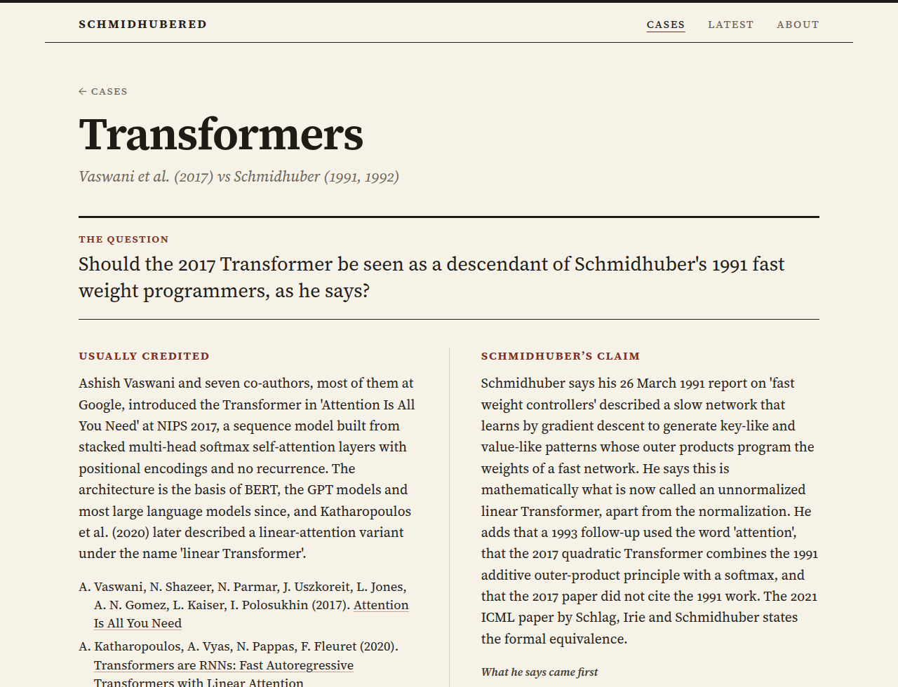

# Schmidhubered

Jürgen Schmidhuber has argued in public for thirty years that results credited to others were published first, often by his own lab and sometimes by researchers he believes were overlooked, and this site takes those claims one at a time. Each case sets out who is usually credited, what he says came first in his own words, how the other side has answered, the facts both accept and the narrow point in dispute, and then asks readers whether the claim holds.

The site is live at [mottopanikeiku.github.io/schmidhubered](https://mottopanikeiku.github.io/schmidhubered/) and is rebuilt every hour so that the vote counts stay current.



## Voting

Every case has an issue in this repository with the `case` label, and a vote is a reaction on its first post: 👍 valid, 😕 partly, 👎 not valid. Reactions limit each GitHub account to one vote and leave the comments for arguments and corrections. Pages read the counts live from the GitHub API, and an hourly build bakes them in for readers without JavaScript or past the API's rate limit.

## Building

Node 22 is all it needs, since nothing is installed from npm:

```
npm run build                     # dist/ from cases/, seed/ and data/
npm run check                     # case schema, wording and every internal link
python3 -m http.server -d dist    # then open http://localhost:8000/
```

`npm run cards` renders a share image per case when Chrome or Chromium is installed, `npm run track` looks for new posts by @SchmidhuberAI, and `npm run sync-issues` opens the voting issue for any case that lacks one (it only prints its plan until you add `--yes`). The workflows in `.github/` run the check on every push, redeploy hourly and run the tracker once a day.

## Where the cases come from

The starting point is a catalogue of 1,126 public statements he made on X, his website, in papers, on mailing lists, Reddit and LinkedIn and in interviews between 1996 and 2026, kept in `seed/`. Each file in `cases/` groups the statements behind one dispute and was written from primary sources, with every quote linked to where it appeared. New posts that the daily tracker flags go to `data/latest.json` and are shown as unreviewed until someone folds them into a case. Corrections are welcome as issues or as pull requests against the case files.

The code is MIT, the case texts are CC BY 4.0 with quotes remaining their authors', and the type is a subset of Source Serif 4 under the SIL Open Font License.
